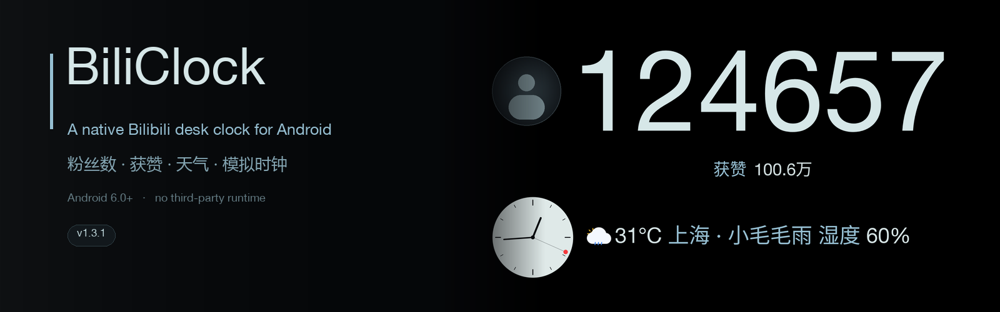
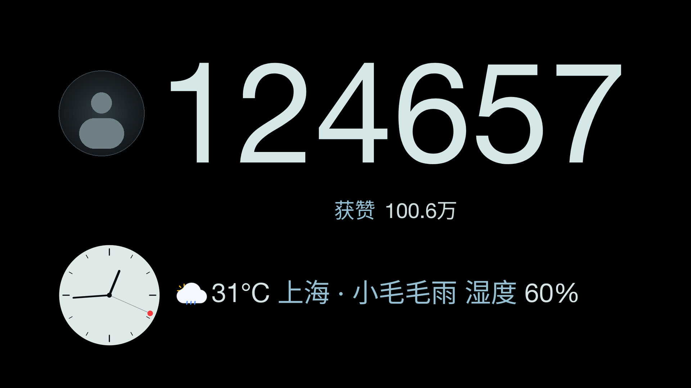
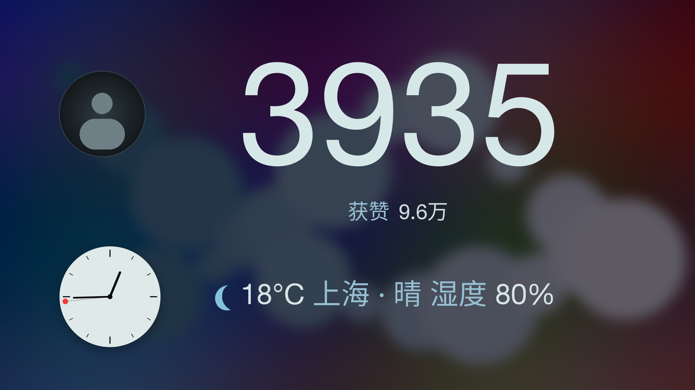
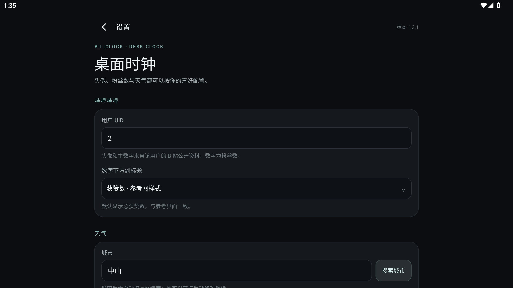
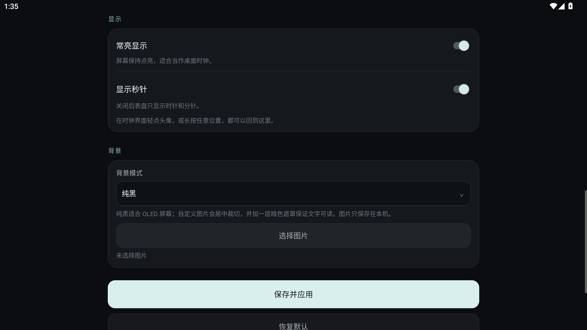

<div align="center">


# BiliClock

**B 站桌面时钟 · 粉丝数 / 获赞 / 天气 / 模拟时钟**

A native, dependency-light Bilibili desk clock for Android.

[](#compatibility)
[](#download)
[](#technical-notes)
[](#technical-notes)
[-blue)](LICENSE)

[下载](#download) · [截图](#screenshots) · [构建](docs/BUILD.md) · [配置](docs/CONFIGURATION.md) · [更新日志](CHANGELOG.md)

</div>



BiliClock 是一个用纯 Java + 自定义 Canvas 绘制的横屏桌面时钟：左侧头像和模拟时钟，右侧显示 B 站粉丝数、获赞数和天气。它不依赖 AndroidX、Compose、Lottie 或 WebView，最低支持 Android 6.0（API 23）。

> 非官方项目，与哔哩哔哩、Open-Meteo、和风天气均无隶属关系。

## Screenshots

| 纯黑背景（默认） | 自定义图片背景 |
| :---: | :---: |
|  |  |
| **设置** | **背景模式** |
|  |  |

## Features

- **B 站资料**：读取指定 UID 的头像、粉丝数和获赞数，支持本机缓存与离线降级。
- **天气**：Open-Meteo（免密钥）、和风天气兼容服务、自定义 JSON 接口；城市可搜索，也可手动填写经纬度。
- **排版**：粉丝数、获赞、天气统一居中在右侧文字区；头像和时钟靠左。
- **字体**：内置 Helvetica Neue LT 55 Roman，拉丁字母和数字使用细字重；中文自动回退系统 CJK 字体。
- **数字颜色**：粉丝数、获赞数值、天气温度和湿度数字为白色/浅色；只有中文和标签使用浅蓝色。
- **背景**：默认纯黑；可在设置中选择本机图片作为背景，居中裁切并加暗色遮罩。
- **静态天气图标**：Meteocons 矢量图标，不做天气动画；秒针仍正常走动。
- **完整设置**：UID、副标题模式、城市、坐标、天气服务器、刷新间隔、常亮、秒针、背景。
- **无第三方运行时依赖**：一个 Activity + 一个自定义 View 完成主界面绘制。

## Download

从 [Releases](../../releases/latest) 下载最新 APK：

```text
BiliClock-1.3.1-debug.apk
```

这是调试签名版本，可直接侧载；正式分发请用自己的发布证书重新签名。源码包也在同一个 Release 中。

> 公开分发包含 Helvetica 字体的 APK 前，请先阅读 [字体授权说明](#fonts-and-licenses)。

## Quick start

1. 安装 APK，横屏启动。
2. 轻点头像，或长按屏幕任意位置，进入设置。
3. 填写 B 站 UID、城市，按需选择天气服务器；点“保存并应用”。
4. 在“背景”卡片中选择纯黑或自定义图片。

默认值：UID `2`、广东中山、Open-Meteo。

## Build

### Android Studio

用 Android Studio 打开仓库根目录，使用 JDK 17，选择 `app` 运行。项目使用 `compileSdk 35`、`targetSdk 34`、`minSdk 23`。

### Command line

需要 JDK 17、Android SDK Platform 35 和 Build-Tools 35.0.0：

```powershell
powershell -NoProfile -ExecutionPolicy Bypass -File scripts/build.ps1
```

也可以显式指定路径：

```powershell
powershell -NoProfile -ExecutionPolicy Bypass -File scripts/build.ps1 `
  -SdkPath "C:\Android\Sdk" `
  -JdkPath "C:\Program Files\Microsoft\jdk-17"
```

输出：`dist/BiliClock-1.3.1-debug.apk`。完整说明见 [docs/BUILD.md](docs/BUILD.md)。

## Configuration

设置项和三种天气后端的请求格式见 [docs/CONFIGURATION.md](docs/CONFIGURATION.md)。

<details>
<summary><b>天气后端速览</b></summary>

- **Open-Meteo**：`/v1/forecast`，读取 `current.temperature_2m`、`relative_humidity_2m`、`weather_code`、`is_day`。
- **和风天气 / 兼容 API**：`/v7/weather/now`，读取 `now.temp`、`text`、`humidity`、`icon`。
- **自定义 JSON**：URL 支持 `{lat}`、`{lon}`、`{city}`、`{key}` 占位符；字段路径支持点号写法，例如 `data.temp`。

</details>

## Technical notes

- **单 Canvas 绘制**：`ClockView` 在 1920×1200 设计坐标中绘制全部内容，按屏幕等比缩放，圆形不会被拉伸。
- **字体回退**：Helvetica 不含中文字形，中文由 Android 系统 Noto Sans CJK 渲染；拉丁字母和数字使用内置 Helvetica。
- **天气图标**：Meteocons SVG 几何被拆成 Android VectorDrawable 图层，再在 Canvas 中静态组合。云和月亮路径使用普通三次贝塞尔曲线，避免旧 Android 的矢量路径解析问题。
- **Android 6 TLS**：内置 ISRG Root X1/X2 和 GlobalSign Root R46，配合复合 TrustManager，解决旧系统根证书缺失。
- **图片背景**：通过 Storage Access Framework 选择图片，复制到应用私有目录；绘制时居中裁切并叠加暗色遮罩，不需要存储权限。

## Compatibility

- Android 6.0（API 23）及以上；`targetSdk 34`。
- 横屏全屏，沉浸式状态栏/导航栏。
- 16:10、16:9、4:3 屏幕等比适配；内容不会拉伸。
- 已在 Android 12（MuMu 12，2560×1440）完整验证；核心绘制代码在 Android 6（API 23 模拟器）验证了界面、字体回退和矢量图标。API 23 模拟器网络未返回实时数据，因此显示占位状态。

## Privacy

- 只申请 `INTERNET` 和 `ACCESS_NETWORK_STATE`；不申请定位、通讯录或存储权限。
- UID、城市、坐标、天气 Key、背景图片和显示设置只保存在本机。
- 背景图片通过系统文件选择器导入，复制到应用私有目录；没有自有服务器上报。
- B 站头像和公开资料、天气数据来自对应第三方接口。

## Fonts and licenses

- **Helvetica Neue LT 55 Roman** (`Helvetica-Regular.ttf`)：由项目方提供。Helvetica 是 Monotype 的商标，该字体文件**不适用**本项目的 MIT 许可证；公开分发前请确认授权，或替换为可再分发的字体。
- **Meteocons** by Bas Milius：MIT License，见 [`app/src/main/assets/METEOCONS-LICENSE.txt`](app/src/main/assets/METEOCONS-LICENSE.txt)。
- 中文回退使用系统 Noto Sans CJK，不随 APK 分发。
- 详细第三方说明见 [THIRD_PARTY_NOTICES.md](THIRD_PARTY_NOTICES.md)。

## Project structure

```text
app/src/main/java/com/biliclock/deskclock/
  MainActivity.java      全屏时钟、刷新调度、背景图加载
  ClockView.java         1920x1200 设计坐标中的全部绘制
  SettingsActivity.java  设置界面与图片选择
  BiliClient.java        B 站公开资料接口
  WeatherClient.java     三种天气后端与城市搜索
  WeatherCode.java       WMO / 和风天气码到中文文案和图标
  MeteoWeatherIcon.java  Meteocons 矢量图标的静态组合
  Tls.java               Android 6 的根证书兼容
  Prefs.java             设置与本地缓存
  Images.java            头像缓存、背景图片导入/解码
  Http.java              轻量 HttpURLConnection 客户端
  Format.java            数字和文案格式
app/src/main/assets/     Helvetica 字体、字体说明、Meteocons 许可证
docs/images/             README 截图与 banner
docs/BUILD.md            构建说明
docs/CONFIGURATION.md    配置与接口说明
scripts/build.ps1        无 Gradle 构建脚本
```

## Changelog

See [CHANGELOG.md](CHANGELOG.md).

## License

Original source code: [MIT](LICENSE). Third-party fonts, icons and certificates
are excluded from the MIT grant; see [THIRD_PARTY_NOTICES.md](THIRD_PARTY_NOTICES.md).

## Acknowledgements

- [Meteocons](https://github.com/basmilius/weather-icons) by Bas Milius
- [Open-Meteo](https://open-meteo.com/)
- [和风天气](https://www.qweather.com/)
- Android Open Source Project
